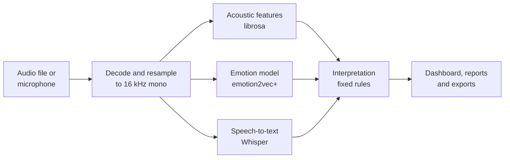

<h1 align="center">
   Velora
</h1>

<p align="center">
  <b>Your voice. Deeper insights.</b><br>
  A web app that analyses <i>how</i> you speak: the emotion in your voice, its acoustic patterns, and an expressive transcript.
</p>

<p align="center">
  <a href="https://velora-cxct3q3kugpgf23ccbtlno.streamlit.app"><b>Open the live app →</b></a>
</p>

<p align="center">
  
  
  
  
</p>


## Contents

- [Overview](#overview)
- [Try it online](#try-it-online)
- [Using the app](#using-the-app)
- [How it works](#how-it-works)
- [Project structure](#project-structure)
- [Running locally](#running-locally)
- [Testing](#testing)
- [Deployment](#deployment)
- [Privacy](#privacy)
- [Limitations](#limitations)

## Overview

### Goal

Most speech tools only answer *what* was said. Velora also answers *how* it was said. It turns a short voice
recording into an emotion estimate, acoustic measurements and an annotated transcript that are easy to read and
honest about where every number comes from.

### What it does

You upload or record a clip, and Velora runs three kinds of analysis on it:

| Analysis | What you get | How it is produced |
|---|---|---|
| **Emotion recognition** | The most likely of seven emotions (neutral, happy, sad, angry, fearful, disgusted, surprised), with probabilities and how the emotion changes over time | Pretrained deep-learning model [emotion2vec+](https://huggingface.co/emotion2vec/emotion2vec_plus_base) |
| **Acoustic analysis** | Pitch, loudness, timbre, speaking rate and pauses, shown as charts | Signal processing with [librosa](https://librosa.org) and NumPy |
| **Expressive transcript** | The words you said, marked by how you said them: louder, softer, higher, rising or falling, or after a pause | Speech-to-text with [Whisper](https://github.com/SYSTRAN/faster-whisper), combined with the measurements above |

Every value on screen is labelled with its source: **Measured** (computed from the signal), **Model output** (raw
prediction from a neural network), or **Interpretation** (text written by fixed rules from the other two). Velora
never invents a result. If a model is unavailable, the app says so and everything else keeps working.

### Who it is for

People practising presentations or interviews, language learners, voice and drama students, and anyone curious
about how their voice comes across.

## Try it online

**Live app: <https://velora-cxct3q3kugpgf23ccbtlno.streamlit.app>**

Nothing needs to be installed and no account is needed. A browser with a microphone is enough to record, or you can
upload an audio file.

- If the page says the app has gone to sleep, click **Yes, get this app back up!** and wait about a minute. Free
  Streamlit apps sleep after a few days without visitors.
- The first analysis after the app wakes up takes one to two minutes while the AI models load. Later analyses take
  about 10 to 20 seconds.

## Using the app

The sidebar on the left has six pages. A typical first visit takes five minutes:

1. Open **Home**, record a 10 to 20 second clip (or upload one), and click **Analyse voice**.
2. Read the dashboard that appears below.
3. Open **Analysis** for the full report and downloads.
4. Try **Live Studio**, reading the same prompt in two different moods.
5. Compare those two takes in **Contrast Lab**.

### Home

The main page for analysing a recording.

- **Input:** upload a file (WAV, MP3, FLAC, OGG, M4A, AAC, WebM or MP4, up to 25 MB), or click the microphone to
  record and click again to stop. **Clear** removes the selection.
- **Results:** a dashboard appears after you click **Analyse voice**:
  - **Emotion:** the predicted emotion, its probability, a *Clear result*, *Likely* or *Uncertain* label, and bars
    for every emotion.
  - **Acoustic analysis:** tabs for the waveform, spectrogram, MFCCs, pitch and energy, and spectral centroid.
  - **Emotion over time:** how the prediction changes across the recording.
  - **Key measurements:** median pitch, loudness, speaking rate, timbre and pauses, each with a plain-language note.
  - **Transcript:** your words with expressive markup. Hover over any word to see its measurements.

### Live Studio

Guided practice. Choose a prompt (free speech or one of seven moods), record yourself reading it, and get instant
feedback. A **Mic check** reports the recording level, background noise and clipping. A **Session takes** table
compares the mood you aimed for with the model's answer for every take.

### Analysis

The full report for one recording, in three clearly separated sections:

1. **Model outputs:** raw emotion scores, the transcript with per-word confidence, and the window-by-window emotion
   timeline.
2. **Measured acoustic features:** every measurement with its unit and meaning, a voice-profile radar chart, and
   recording-quality figures.
3. **Interpretation:** the expressive transcript and a written summary.

**Downloads:** the original audio, transcript (.txt), full analysis (.json), metrics and frame tracks (.csv), emotion
timeline (.csv), the analysed 16 kHz audio (.wav) and a 2 to 3 page **PDF report**.

### History

All saved analyses, with search, filters and charts of the predicted emotions over time. Select a row to replay it,
open it in Analysis, send it to Contrast Lab, rename it, delete it or download it. On the live site, history lasts
only for your browser session (see [Privacy](#privacy)).

### Contrast Lab

Choose two recordings, A and B, from History, by upload or by recording, and compare them:

- **Overview:** a plain-language summary, a table of measured differences and both voice profiles on one radar chart.
- **Same words, different delivery:** when both clips say the same sentence, a word-by-word comparison of timing,
  stress and pitch.
- **Emotion model:** both sets of emotion probabilities and timelines side by side.
- **Pitch & energy:** both pitch contours overlaid.

Download the comparison as a Markdown report or as a ZIP bundle with all the data and both audio files.

### About

The methods, the status of both models, the known limitations, and the privacy policy.

### Engine settings

In the sidebar, **Engine settings** can switch either model off, choose the Whisper model size (`base` is more
accurate, `tiny` is faster), set the transcription language, and turn off saving to History.

## How it works



1. **Decode.** The audio is decoded (PyAV handles M4A, WebM and MP4 without a system FFmpeg), mixed to mono and
   resampled to 16 kHz. Clips longer than 3 minutes are truncated, and clips shorter than 0.5 seconds are rejected.
2. **Measure.** librosa computes frame-level tracks every 20 ms: pitch with the pYIN algorithm (65 to 500 Hz), RMS
   energy, spectral centroid, rolloff, bandwidth and flatness, zero-crossing rate and MFCCs. From these, Velora
   derives clip statistics such as speaking rate (from syllable peaks), pauses (silences of 250 ms or more), and
   jitter and shimmer.
3. **Classify.** emotion2vec+ scores the whole clip, then overlapping 3-second windows to build the timeline. Its
   probabilities are shown exactly as the model outputs them; the model's "other" and "unknown" outputs are reported
   together as *Other*.
4. **Transcribe.** faster-whisper (int8, on the CPU) transcribes the speech with word-level timestamps.
5. **Interpret.** Each word is matched to the measurements over its time span. A word is marked **bold** if it is at
   least 3 dB louder than your median word, *italic* if at least 5 dB softer, and underlined if at least 3 semitones
   above your median pitch. Arrows show pitch rising or falling within a word, and pause marks show measured gaps.
   A short summary paragraph is written by fixed rules.

### Technology

| Area | Tools |
|---|---|
| Web app and UI | [Streamlit](https://streamlit.io), [Plotly](https://plotly.com/python/) |
| Signal processing | [librosa](https://librosa.org), NumPy, SciPy, [PyAV](https://pyav.org) |
| Emotion recognition | [emotion2vec+ base](https://huggingface.co/emotion2vec/emotion2vec_plus_base) via [FunASR](https://github.com/modelscope/FunASR), PyTorch (CPU) |
| Speech-to-text | [faster-whisper](https://github.com/SYSTRAN/faster-whisper) (`base` or `tiny`) |
| Reports and storage | fpdf2 (PDF), SQLite (local history) |
| Quality | pytest, Playwright (browser tests), Ruff (linting) |

## Project structure

```
velora/
├── app.py                    Entry point: page navigation, theme and sidebar
│
├── views/                    One module per page
│   ├── home.py               Upload or record, then the results dashboard
│   ├── live_studio.py        Guided prompts, mic check and session takes
│   ├── analysis.py           Full report and all downloads
│   ├── history.py            Saved analyses: search, charts and actions
│   ├── contrast_lab.py       Side-by-side comparison of two recordings
│   └── about.py              Methods, model status, limitations and privacy
│
├── velora/                   Core package (no page code)
│   ├── pipeline.py           End-to-end analysis: decode → measure → classify → transcribe → interpret
│   ├── audio.py              Decoding, resampling and recording-quality checks
│   ├── features.py           Acoustic feature extraction with librosa
│   ├── emotion.py            emotion2vec+ wrapper: loading, windows and timeline
│   ├── transcribe.py         faster-whisper wrapper with word timestamps
│   ├── interpret.py          Rule-based summary and expressive transcript markup
│   ├── contrast.py           Comparison logic and comparison reports
│   ├── exports.py            TXT, JSON, CSV and PDF exports
│   ├── storage.py            History: SQLite locally, in-memory per session when hosted
│   ├── charts.py             Plotly figures
│   ├── dashboard.py          Result sections shared by several pages
│   └── ui.py                 Theme, sidebar, shared components and the analysis runner
│
├── tests/                    Automated tests
│   ├── test_app.py           Pipeline and every page rendered headlessly
│   ├── test_emotion.py       Emotion model wrapper
│   ├── test_exports.py       Every audio format, invalid files, exports and storage
│   ├── test_contrast.py      Contrast Lab comparisons
│   ├── make_fixtures.py      Generates test audio in every supported format
│   └── e2e/e2e_browser.py    End-to-end test in a real browser with a simulated microphone
│
├── assets/                   Logo and icon
├── docs/                     Images used in this README
├── scripts/run_velora.bat    One-click launcher for Windows
├── .streamlit/config.toml    Theme, upload limit and server settings
├── requirements.txt          Runtime dependencies (also used by Streamlit Cloud)
├── requirements-dev.txt      Test and lint tools
└── pyproject.toml            Project metadata, Ruff and pytest configuration
```

The pages in `views/` only lay out the screen. All analysis logic lives in the `velora/` package, so it can be
tested without a browser.

## Running locally

Requires **Python 3.13 or 3.14**. No GPU or FFmpeg install is needed.

```bash
git clone https://github.com/cyraemin/velora.git
cd velora
python -m venv .venv
```

Activate the environment (`.venv\Scripts\activate` on Windows, `source .venv/bin/activate` on macOS and Linux), then:

```bash
pip install -r requirements.txt
streamlit run app.py
```

Open <http://localhost:8501>. The models (about 0.5 GB) download during the first analysis and are cached for later
runs, so the app then works offline.

> **Windows:** run `pip install torch==2.14.1 --index-url https://download.pytorch.org/whl/cpu` before installing the
> requirements, to get the smaller CPU-only PyTorch build. Afterwards you can start the app by double-clicking
> `scripts\run_velora.bat`.

## Testing

```bash
pip install -r requirements-dev.txt
ruff check .     # linting
pytest           # 38 unit and page tests
```

The unit tests cover the analysis pipeline, decoding of every supported format, invalid and silent files, every
export including the PDF, both storage modes, Contrast Lab, and every page rendered headlessly.

The end-to-end test drives the running app in Microsoft Edge. It uploads files, records through a simulated
microphone, clicks every download and checks each page for errors (31 checks):

```bash
python tests/make_fixtures.py <speech.wav> <fixtures_dir>
streamlit run app.py   # in a second terminal
python tests/e2e/e2e_browser.py <fixtures_dir> <speech.wav>
```

## Deployment

The live app runs on [Streamlit Community Cloud](https://share.streamlit.io) straight from this repository (branch
`main`, main file `app.py`). Every push to `main` redeploys it automatically. `requirements.txt` pins CPU-only
PyTorch builds for Linux, so the install stays small.

The app needs no API keys or secrets. Any added later belong in `.streamlit/secrets.toml`, which is git-ignored.

## Privacy

- **Live app:** audio is processed on the server and never stored on disk. History is kept in memory for your
  browser session only, other visitors cannot see it, and it is discarded when you close the tab.
- **Running locally:** audio never leaves your computer. History is saved in the `data/` folder, which is
  git-ignored. You can delete it from the History page or turn saving off in Engine settings.
- The only outbound network access is the one-time model download from Hugging Face.

## Limitations

- Emotion recognition is an estimate. Real feelings are often mixed or subtle, and results are less reliable for
  very short, quiet or noisy recordings. The *Uncertain* label marks results where two emotions score closely.
- Absolute loudness depends on the microphone and its gain, so compare levels only between clips recorded the same
  way.
- Jitter and shimmer are frame-level approximations, not clinical voice measures.
- Velora is not a psychological or medical assessment.
