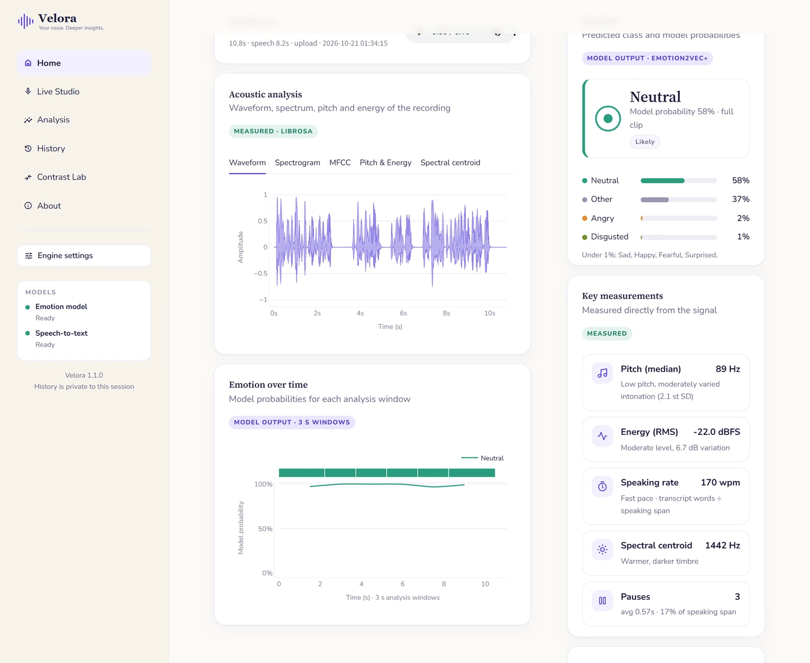

<h1 align="center">
   Velora
</h1>

<p align="center">
  <b>Your voice. Deeper insights.</b><br>
  Voice emotion recognition, acoustic analysis and expressive transcription, in your browser.
</p>

<p align="center">
  
  
  
</p>



## Features

- **Emotion recognition**: a pretrained wav2vec 2.0 model classifies speech as neutral, happy, angry or sad, for the whole clip and over time.
- **Acoustic analysis**: pitch, energy, timbre, speaking rate and pauses, with waveform, spectrogram and MFCC views.
- **Expressive transcript**: Whisper transcribes the speech, and each word is marked up by how it was said (louder, softer, higher, rising or falling, pauses).
- **Contrast Lab**: compare two recordings side by side, down to the delivery of individual shared words.
- **Live Studio**: guided prompts for recording in different moods, with a microphone check.
- **Exports**: PDF report, JSON, CSV, transcript and audio for every analysis.

Every value is labelled as **measured** from the signal, raw **model output**, or rule-based **interpretation**.
If a model is unavailable, Velora says so; it never fills in a result.

## Getting started

Requires **Python 3.13** (3.14 also works). No GPU or FFmpeg install is needed.

```bash
git clone https://github.com/cyraemin/velora.git
cd velora
python -m venv .venv
```

Activate the environment (`.venv\Scripts\activate` on Windows, `source .venv/bin/activate` on macOS and Linux), then:

```bash
pip install -r requirements.txt
streamlit run app.py
```

Open <http://localhost:8501>. The models (~0.5 GB) download on the first analysis and are cached for offline use.

> **Windows:** run `pip install torch==2.14.1 --index-url https://download.pytorch.org/whl/cpu` first to get the
> smaller CPU-only PyTorch build. Afterwards you can start the app with `scripts\run_velora.bat`.

## Deployment

Velora runs on [Streamlit Community Cloud](https://share.streamlit.io) as is:

1. Choose **Create app**, select this repository, branch `main` and main file `app.py`.
2. Deploy. Python 3.13 and 3.14 are both supported.

When hosted, history is kept **in memory for each browser session only**. Visitors never see each other's
recordings, and nothing is written to disk. On other hosts, set `VELORA_STORAGE=session` to get the same behaviour.

The app needs no API keys. Any secrets you add later belong in `.streamlit/secrets.toml` (git-ignored), not in code.

## Privacy

Run locally, audio never leaves your computer. History is saved in `data/`, which is git-ignored, and can be
deleted from the **History** page or switched off in **Engine settings**. The only network access is the
one-time model download from Hugging Face.

## Development

```bash
pip install -r requirements-dev.txt
ruff check .
pytest
```

## Project structure

```
├── app.py              Entry point and page navigation
├── velora/             Core package: audio, features, models, exports, storage, UI
├── views/              One module per page
├── tests/              pytest suite (tests/e2e/ holds the browser test)
├── assets/             Logo and icon
├── docs/               README images
└── scripts/            Windows launcher
```

## Models

| Task | Model |
|---|---|
| Emotion | [`superb/wav2vec2-base-superb-er`](https://huggingface.co/superb/wav2vec2-base-superb-er), trained on IEMOCAP |
| Speech-to-text | [faster-whisper](https://github.com/SYSTRAN/faster-whisper), `base` or `tiny` |

## Limitations

The emotion model has four classes and was trained on acted English speech, so it can be wrong for other
languages, accents or noisy audio. Velora is not a psychological or medical assessment.
